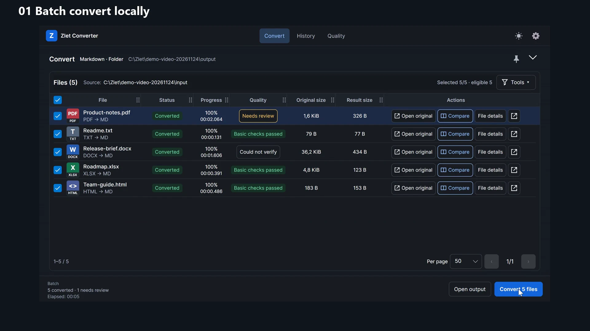
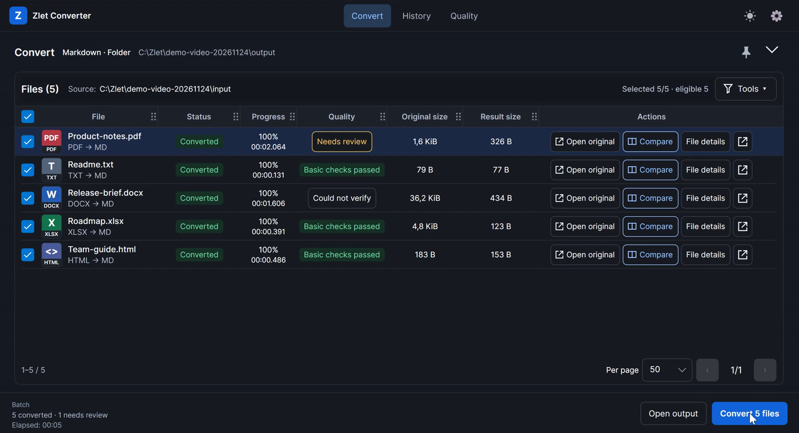
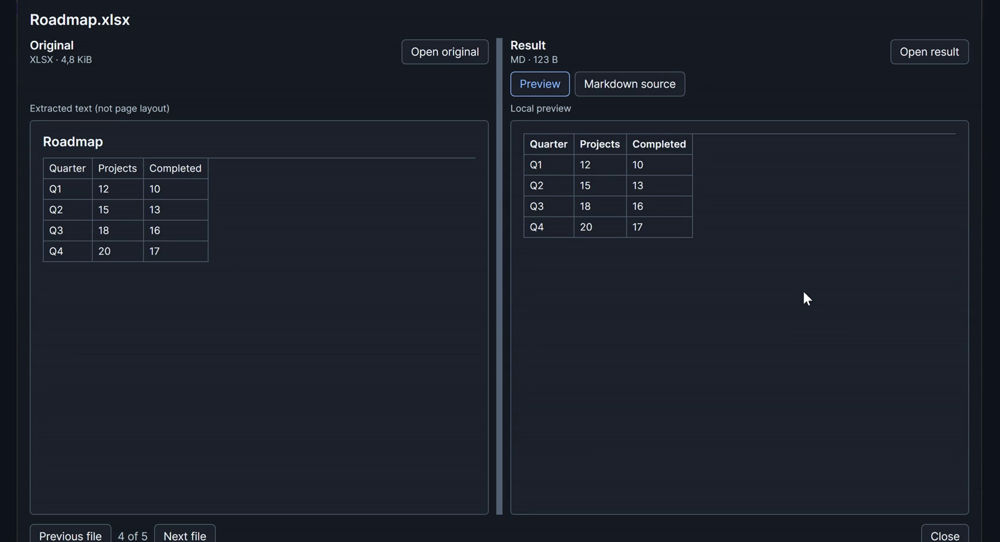
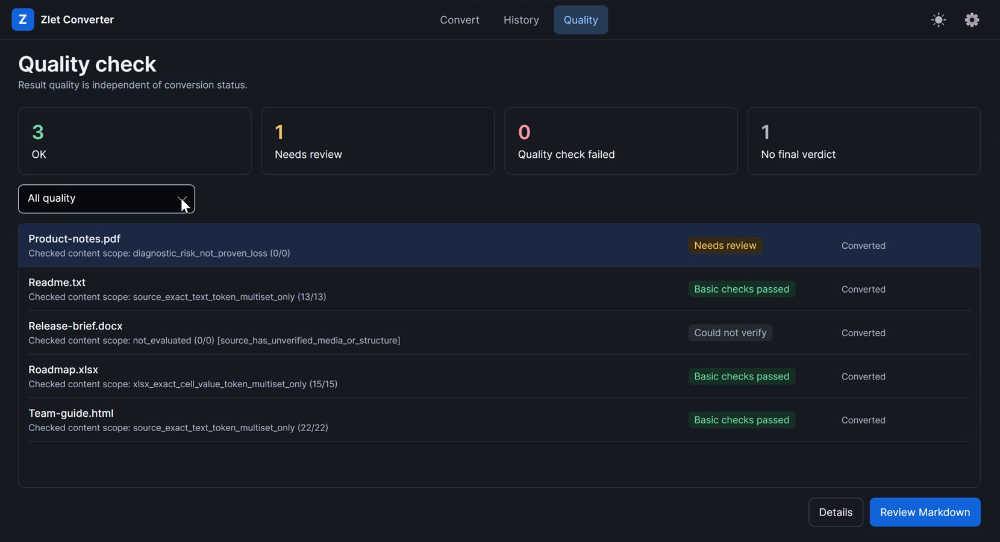
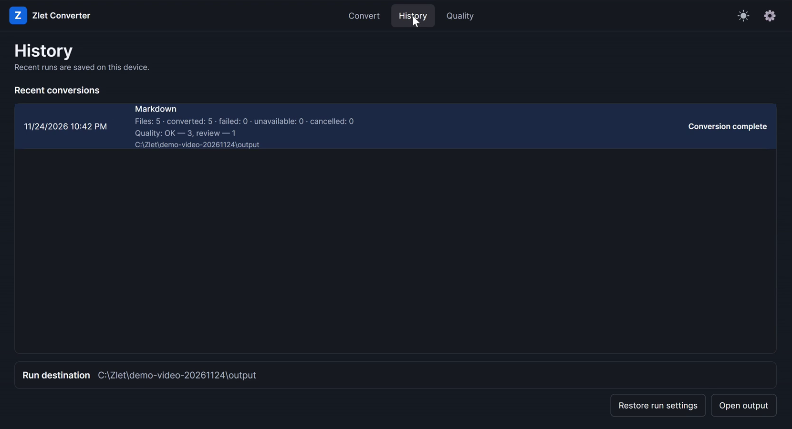

# Zlet Converter

[English](README.md) · [Русский](README_RU.md) · [Website](https://zlet.app/converter)

**Turn documents into useful Markdown. On your own computer.**

Zlet Converter is a Windows desktop app for local batch document conversion, with visible conversion status, Basic Quality Check and original/result comparison.

   

## Download 0.1.2

[**Windows installer (.exe)**](https://github.com/zlet-labs/zlet-converter-releases/releases/download/v0.1.2/ZletConverter-v0.1.2-Setup-win-x64.exe) · [**Portable (.zip)**](https://github.com/zlet-labs/zlet-converter-releases/releases/download/v0.1.2/ZletConverter-0.1.2-win-x64.zip) · [Release notes](https://github.com/zlet-labs/zlet-converter-releases/releases/tag/v0.1.2) · [SHA-256](https://github.com/zlet-labs/zlet-converter-releases/releases/download/v0.1.2/SHA256SUMS.txt)

Windows x64 · Public Beta · Free for personal, non-commercial use. No account required. The installer is unsigned; Windows may show an unknown-publisher warning. The .NET runtime is included.

## Zlet Converter 0.1.1 in action

[**Watch the 32.5-second demo**](https://zlet.app/converter) · [Silent MP4](assets/demo/demo-silent.mp4)

Comparison, quality checks and history

Real native Windows recording of the published 0.1.1 build with five generated sample files. Conversion success does not guarantee result quality. [Capture provenance](assets/screenshots/README.md).

## Why Zlet Converter

- **Local-first:** supported conversions process documents on your computer; no mandatory cloud service or LLM API.
- **Batch workflow:** add files or folders, select what to convert and export to a folder or ZIP.
- **Review results:** compare the original and output, see file sizes, status and diagnostic messages.
- **Quality-aware:** Basic Quality Check is separate from conversion status. A completed conversion can still need review.
- **Practical desktop app:** Russian and English, light/dark/system appearance, local conversion history.

## Supported formats

| Input | Output | Scope |
| --- | --- | --- |
| DOCX, XLSX, PPTX | Markdown | Local conversion |
| DOC, XLS | Markdown | No installed Office required |
| PPT | Markdown | Requires installed PowerPoint |
| PDF | Markdown | Text-oriented subset; no bundled OCR |
| HTML, HTM, TXT | Markdown | Local conversion; HTML image export has limitations |
| DOC, XLS, PPT | DOCX, XLSX, PPTX | Requires matching installed Microsoft Office application |

Complex documents may need review or be explicitly unsupported. Some complex tables use embedded HTML in Markdown to retain structure.

## How it works

1. Install or extract the portable ZIP completely and run `ZletConverter.exe`.
2. Add documents or a folder.
3. Choose the conversion and destination (folder or ZIP).
4. Convert and check per-file status.
5. Review quality and compare important results with the originals.

## Quality and privacy

Conversion success is not a guarantee of semantic fidelity. Check important tables, formulas, images and reading order. Unsupported routes and partial results are reported explicitly.

Documents are processed locally; no mandatory registration, cloud backend or LLM API. The product does not automatically replace unavailable local Office routes with cloud conversion.

Read the [quality methodology and release QA results](https://zlet.app/converter/quality).

## Release information

- [What's new and known limitations in 0.1.2](https://github.com/zlet-labs/zlet-converter-releases/releases/tag/v0.1.2)
- [All versions](https://github.com/zlet-labs/zlet-converter-releases/releases)
- [Report a problem or request a feature](https://github.com/zlet-labs/zlet-converter-releases/issues)
- [Free Personal License](LICENSE_FREE_BETA1.txt)

Free is licensed for personal, non-commercial use only. Commercial use, redistribution and modification of Zlet Labs-owned components require written permission subject to the license and applicable law. Historical MIT-licensed releases and independently licensed components retain their existing rights.

This is the official public distribution repository. Production source code and engineering infrastructure are maintained separately.

---

Built by [Zlet Labs](https://github.com/zlet-labs) · [zlet.app](https://zlet.app/)
