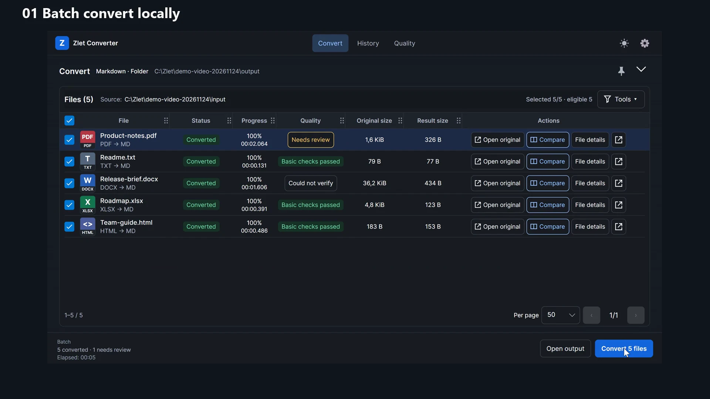
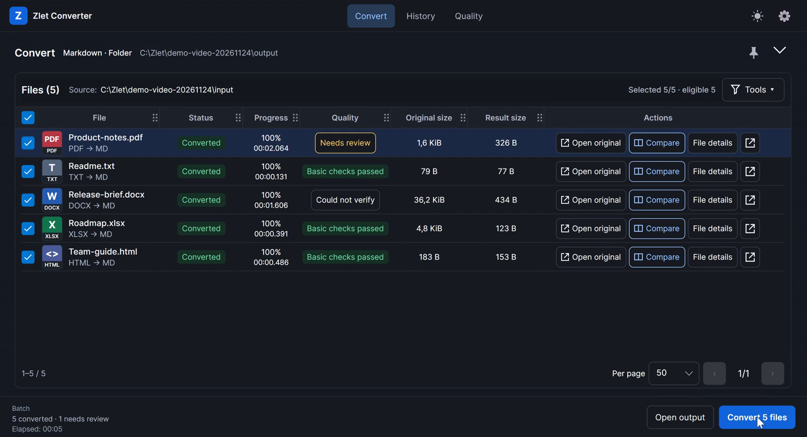
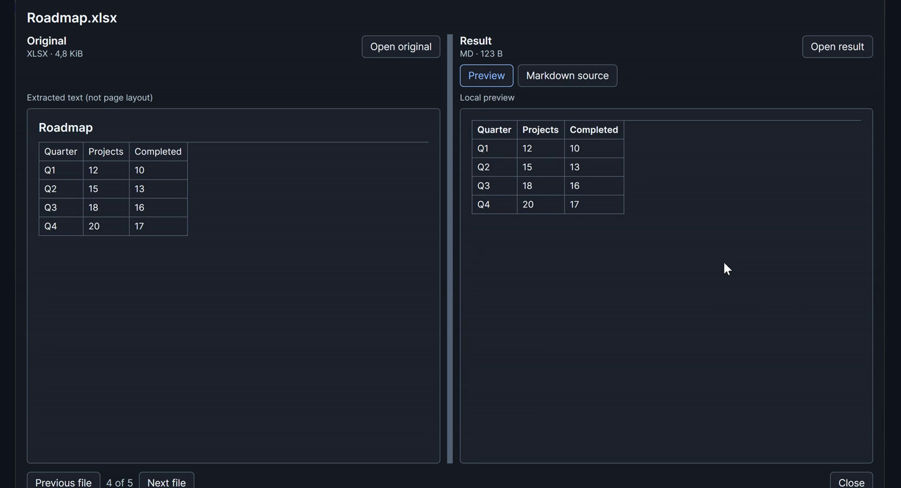
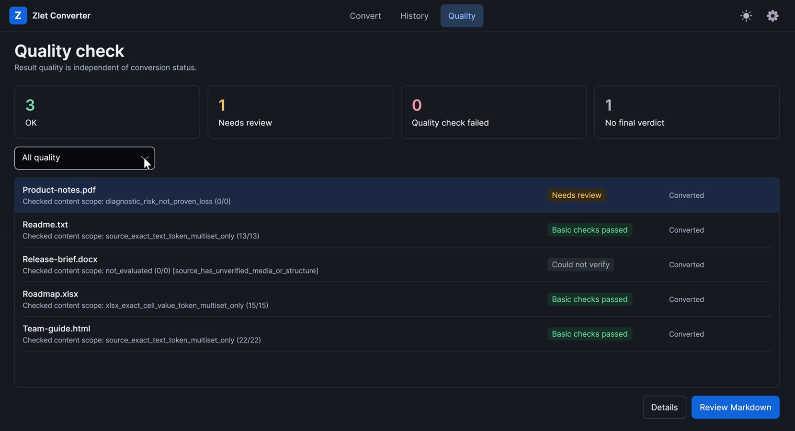
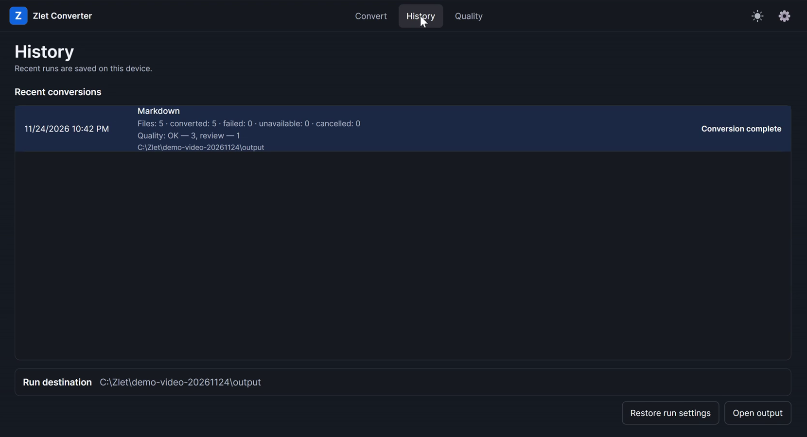

# Zlet Converter

[English](README.md) · [Русский](README_RU.md) · [Сайт](https://zlet.app/converter)

**Конвертируйте документы в удобный Markdown на своём компьютере.**

Zlet Converter — приложение для Windows: пакетная локальная конвертация документов, явные статусы, базовая проверка качества и сравнение оригинала с результатом.

   

## Скачать 0.1.2

[**Установщик Windows (.exe)**](https://github.com/zlet-labs/zlet-converter-releases/releases/download/v0.1.2/ZletConverter-v0.1.2-Setup-win-x64.exe) · [**Portable (.zip)**](https://github.com/zlet-labs/zlet-converter-releases/releases/download/v0.1.2/ZletConverter-0.1.2-win-x64.zip) · [Описание релиза](https://github.com/zlet-labs/zlet-converter-releases/releases/tag/v0.1.2) · [SHA-256](https://github.com/zlet-labs/zlet-converter-releases/releases/download/v0.1.2/SHA256SUMS.txt)

Windows x64 · Публичная бета · Бесплатно для личного некоммерческого использования. Аккаунт не требуется. Установщик не подписан цифровой подписью: Windows может показать предупреждение о неизвестном издателе. Среда .NET включена.

## Интерфейс 0.1.1

[**Смотреть демо на сайте (32,5 сек.)**](https://zlet.app/ru/converter) · [MP4 без звука](assets/demo/demo-silent.mp4)

Сравнение, проверка качества и история

Запись реальной работы опубликованной Windows-сборки 0.1.1 с пятью демонстрационными файлами. Успех конвертации не гарантирует качество каждого результата. [Происхождение кадров](assets/screenshots/README.md).

## Возможности

- **Локальная обработка:** поддерживаемые преобразования выполняются на компьютере, без обязательного облака или LLM API.
- **Пакетная работа:** добавление файлов и папок, выбор документов, экспорт в папку или ZIP.
- **Просмотр результата:** сравнение с оригиналом, размеры файлов, статусы и диагностика.
- **Контроль качества:** базовая проверка качества отделена от статуса конвертации. Успешный результат может требовать проверки.
- **Рабочий интерфейс:** русский и английский языки, светлая, тёмная и системная темы, локальная история.

## Поддерживаемые форматы

| Исходник | Результат | Условия |
| --- | --- | --- |
| DOCX, XLSX, PPTX | Markdown | Локальная конвертация |
| DOC, XLS | Markdown | Установленный Office не нужен |
| PPT | Markdown | Нужен установленный PowerPoint |
| PDF | Markdown | Текстовое подмножество; встроенного OCR нет |
| HTML, HTM, TXT | Markdown | Локально; экспорт изображений HTML имеет ограничения |
| DOC, XLS, PPT | DOCX, XLSX, PPTX | Нужно соответствующее приложение Microsoft Office |

Сложные документы могут потребовать проверки или получить явный статус «Не поддерживается». Для сохранения структуры сложных таблиц может использоваться HTML внутри Markdown.

## Как пользоваться

1. Установите программу или полностью распакуйте portable ZIP и запустите `ZletConverter.exe`.
2. Добавьте документы или папку.
3. Выберите преобразование и место сохранения (папка или ZIP).
4. Запустите конвертацию и проверьте статусы файлов.
5. Проверьте качество и сравните важные результаты с оригиналами.

## Качество и приватность

Успех конвертации не гарантирует полного сохранения содержания и структуры. Проверяйте важные таблицы, формулы, изображения и порядок чтения. Неподдерживаемые маршруты и частичные результаты обозначаются явно.

Документы обрабатываются локально. Нет обязательной регистрации, облачного сервиса или LLM API. Недоступные локальные маршруты Office не заменяются облачными автоматически.

Подробнее: [методология качества и результаты релизной проверки](https://zlet.app/ru/converter/quality).

## Информация о релизе

- [Изменения и известные ограничения 0.1.2](https://github.com/zlet-labs/zlet-converter-releases/releases/tag/v0.1.2)
- [Все версии](https://github.com/zlet-labs/zlet-converter-releases/releases)
- [Сообщить о проблеме или предложить функцию](https://github.com/zlet-labs/zlet-converter-releases/issues)
- [Лицензия Free Personal](LICENSE_FREE_BETA1.txt)

Free предназначена только для личного некоммерческого использования. Коммерческое использование, распространение и изменение принадлежащих Zlet Labs компонентов требуют письменного разрешения с учётом условий лицензии и закона. Права на исторические MIT-релизы и компоненты под независимыми лицензиями сохраняются.

Это официальный публичный репозиторий загрузок. Исходный код и инженерная инфраструктура находятся отдельно.

---

[Zlet Labs](https://github.com/zlet-labs) · [zlet.app](https://zlet.app/)
